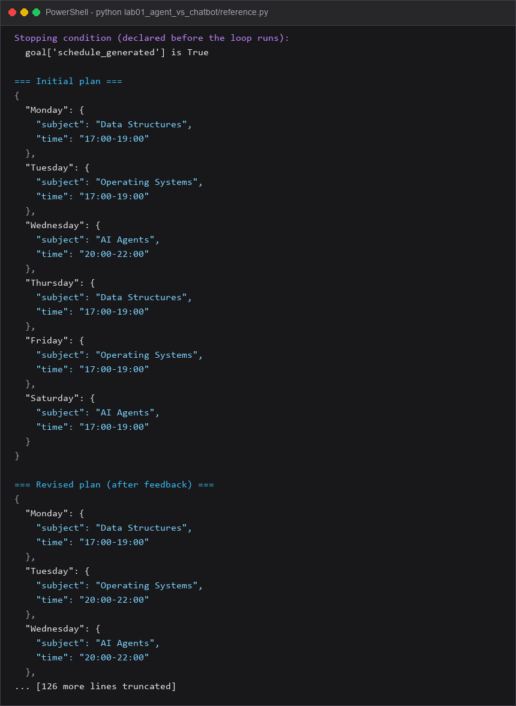
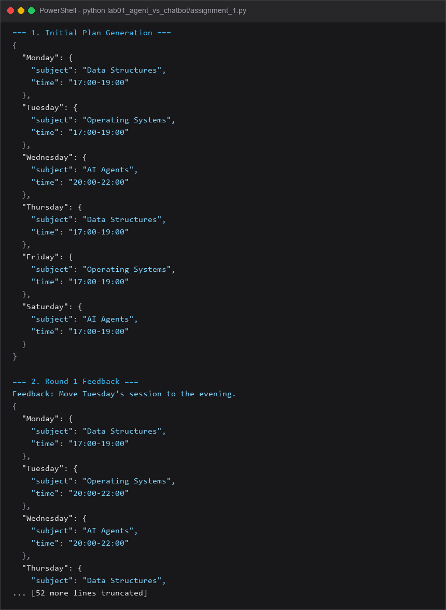
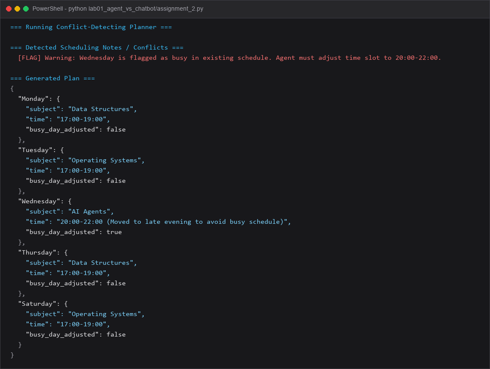

# Lab 1: Agent vs Chatbot (Study Planner)

## Overview
Demonstrates the full `Goal -> Plan -> Act -> Observe -> Revise` agentic loop where:
1. Stopping condition is declared as a checkable data predicate before the loop starts.
2. The agent only asks for missing requirements rather than a fixed survey.
3. Feedback mutates the existing plan object in-place rather than regenerating from scratch.

---

## 1. Reference Implementation (`reference.py`)
* **File**: [`reference.py`](./reference.py)
* **Execution**: `python reference.py`

### Captured Output Screenshot

---

## 2. Assignment 1: Two Rounds of Feedback (`assignment_1.py`)
* **File**: [`assignment_1.py`](./assignment_1.py)
* **Execution**: `python assignment_1.py`
* **Objective**: Accepts two independent rounds of feedback (Round 1: Tuesday to evening; Round 2: Friday shortened to 1 hr). Both mutate the exact same `self.plan` in-place, recording separate revise iterations in the log.

### Captured Output Screenshot

---

## 3. Assignment 2: Detect a Scheduling Conflict Pre-Finalization (`assignment_2.py`)
* **File**: [`assignment_2.py`](./assignment_2.py)
* **Execution**: `python assignment_2.py`
* **Objective**: `read_existing_schedule` returns multiple busy days. Pre-generation hook detects clashes with unavailable days and flags them explicitly rather than silently double-booking.

### Captured Output Screenshot

