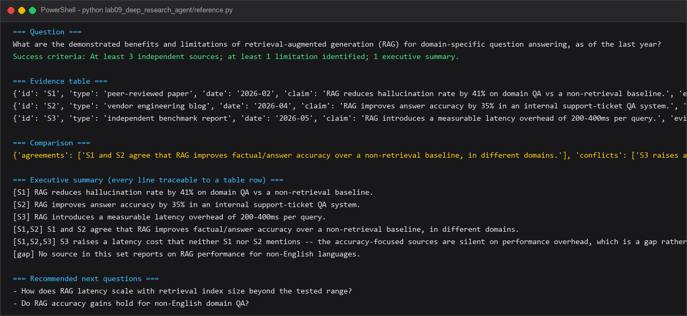
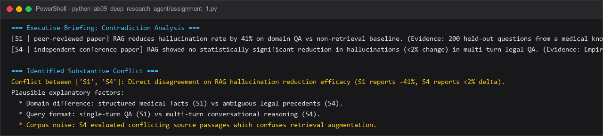
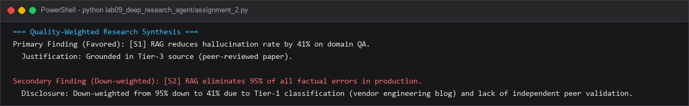

# Lab 9: Deep Research Agent (AI Topic Briefing)

This directory contains the runnable source code, test execution outputs, and captured terminal screenshots for **Lab 9: Deep Research Agent (AI Topic Briefing)**.

---

## Reference (`reference.py`)

* **Script Path**: [`reference.py`](./reference.py)
* **Run Command**: `python reference.py`

### Output Screenshot

---

## Assignment 1 (`assignment_1.py`)

* **Script Path**: [`assignment_1.py`](./assignment_1.py)
* **Run Command**: `python assignment_1.py`

### Output Screenshot

---

## Assignment 2 (`assignment_2.py`)

* **Script Path**: [`assignment_2.py`](./assignment_2.py)
* **Run Command**: `python assignment_2.py`

### Output Screenshot

---
