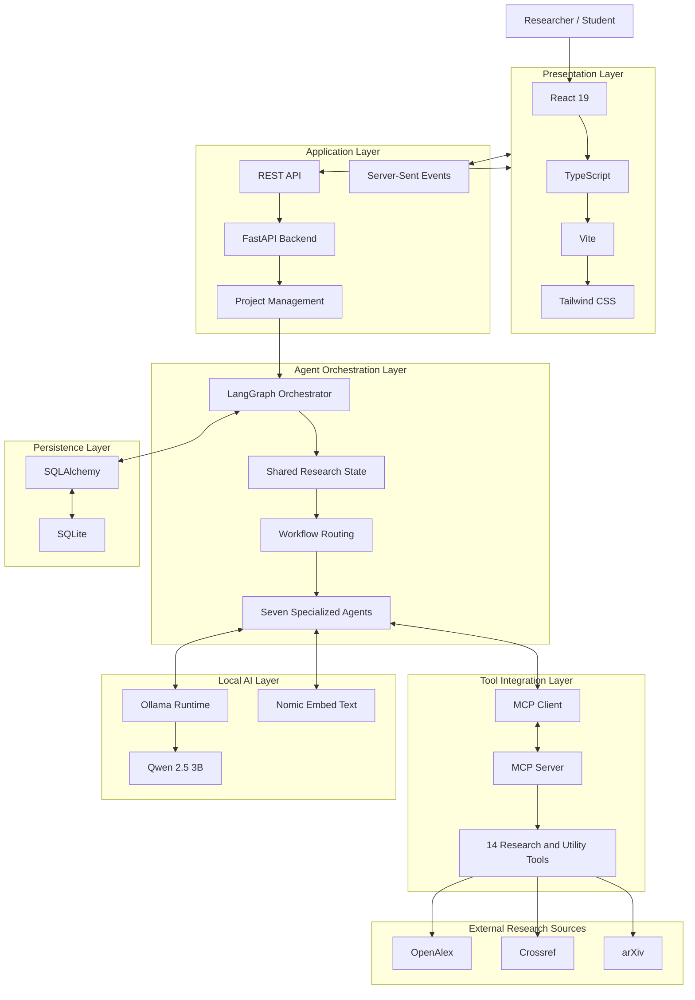
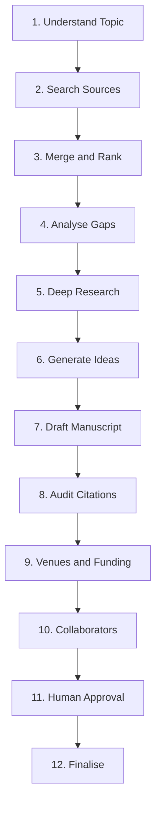

# ResearchOS
### Agentic AI Research Intelligence Platform

<p align="center">
  <strong>From Research Questions to Evidence-Driven Insights.</strong>
</p>

<p align="center">
  A multi-agent AI research workspace that automates scholarly literature discovery, research gap analysis, idea generation, academic drafting, and citation validation through an orchestrated agentic workflow.
</p>

<p align="center">
  
  
  
  
  
  
  
</p>

---

## Overview

ResearchOS is an Agentic AI Research Intelligence Platform designed to assist researchers, students, and academic teams throughout the research lifecycle.

Traditional research workflows require researchers to manually discover academic papers, review literature, identify research gaps, formulate research questions, explore methodologies, prepare manuscripts, and verify citations.

ResearchOS brings these activities into one integrated, multi-agent workspace.

It combines:

- **Multi-agent intelligence:** Seven specialized agents coordinated through a structured research workflow.
- **Agent orchestration:** LangGraph for stateful, multi-step execution.
- **Standardized tool integration:** Model Context Protocol (MCP) for connecting agents to research tools.
- **Live scholarly retrieval:** OpenAlex, Crossref, and arXiv integrations.
- **Local AI inference:** Ollama with Qwen 2.5 3B.
- **Semantic representations:** Nomic Embed Text.
- **Research persistence:** SQLite and SQLAlchemy.
- **Full-stack interface:** React, TypeScript, and FastAPI.

The platform is designed around an important principle:

> Evidence before conclusions. Real research sources before generated answers.

ResearchOS aims to avoid fabricated papers, simulated execution progress, and unsupported research claims. When a service or model is unavailable, the system should communicate that limitation rather than pretending the operation succeeded.

---

## Key Features

### 1. Multi-Agent Research System

A multi-agent architecture separates research responsibilities into specialized components.

The seven-agent design supports activities such as:

- Research planning and topic understanding.
- Literature discovery.
- Research gap identification.
- Deep research and synthesis.
- Research idea generation.
- Academic manuscript drafting.
- Citation and research validation.

Agents are coordinated through the LangGraph workflow rather than operating as unrelated chatbots.

### 2. Live Academic Literature Discovery

Retrieve scholarly metadata from multiple external research sources:

| Source | Purpose |
|---|---|
| OpenAlex | Scholarly works, authors, institutions, and research metadata |
| Crossref | DOI-based publication metadata and references |
| arXiv | Research preprints and academic papers |

The platform combines retrieved records, normalizes metadata, and supports deduplication and ranking.

Retrieved papers are intended to remain traceable to their original scholarly sources.

### 3. Research Gap Identification

Analyze retrieved literature to identify possible research gaps, including:

- Methodological limitations.
- Unexplored research directions.
- Dataset limitations.
- Evaluation challenges.
- Opportunities for further investigation.

Research gaps should be linked to supporting literature wherever evidence is available.

### 4. Deep Research

Break a broad research topic into smaller research questions.

The research workflow can use these questions to guide additional scholarly retrieval and evidence-based synthesis.

### 5. Research Idea Generation

Generate potential research directions using the retrieved literature and identified gaps.

Research ideas can include:

- Research problem.
- Proposed direction.
- Research questions.
- Potential methodology.
- Evaluation metrics.
- Expected research contribution.

Generated ideas are suggestions for investigation, not established scientific findings.

### 6. Academic Manuscript Generation

Generate structured academic drafts using the research evidence collected during the workflow.

The manuscript workflow supports section-oriented drafting and review of research content.

### 7. Citation Verification

Support citation auditing through DOI resolution, publication metadata checks, and bibliography validation.

The purpose is to improve citation reliability and make references easier to inspect.

### 8. Research Venues and Funding

Support exploration of:
- Academic publication venues.
- Research funding opportunities.
- Potential collaborators.
- Researcher and author relationships.

### 9. Human Approval and Governance

Include a human review checkpoint before final publication or export-related operations.

The intended design keeps important research decisions reviewable rather than treating generated content as automatically approved.

### 10. Project Isolation and Auditability

The platform is designed to maintain separate research projects, preserve workflow records, and provide visibility into research execution.

---

## System Architecture

ResearchOS follows a layered, multi-agent architecture.

### High-Level Architecture



### Architecture Layers

| Layer | Technology | Responsibility |
|---|---|---|
| Presentation | React, TypeScript, Vite | User interface and research workspace |
| Styling | Tailwind CSS | Responsive UI and visual design |
| Application | FastAPI, Uvicorn | Backend APIs and application logic |
| Orchestration | LangGraph | Stateful agent execution and workflow coordination |
| Agent System | Seven specialized agents | Research planning, analysis, drafting, and validation |
| Tool Integration | MCP | Standardized research tool access |
| Scholarly Sources | OpenAlex, Crossref, arXiv | External academic literature retrieval |
| LLM Runtime | Ollama | Local language-model inference |
| Language Model | Qwen 2.5 3B | Research-oriented language generation |
| Embeddings | Nomic Embed Text | Text embeddings and semantic representation |
| Persistence | SQLite, SQLAlchemy | Research projects and application data |

---

## Research Workflow

The application organizes research execution into twelve major stages.



### Workflow Explanation

| Stage | Name | Description |
|---|---|---|
| 1 | Understand Topic | Interpret the research topic and prepare the research plan |
| 2 | Search Sources | Retrieve papers from OpenAlex, Crossref, and arXiv |
| 3 | Merge and Rank | Normalize, deduplicate, rank, and store retrieved papers |
| 4 | Analyse Gaps | Identify potential gaps supported by retrieved literature |
| 5 | Deep Research | Decompose topics into sub-questions and synthesize evidence |
| 6 | Generate Ideas | Propose research questions, methods, and metrics |
| 7 | Draft Manuscript | Generate structured academic content |
| 8 | Audit Citations | Resolve DOIs and inspect bibliography references |
| 9 | Venues and Funding | Explore publication venues and funding opportunities |
| 10 | Collaborators | Identify author overlap and potential collaborators |
| 11 | Human Approval | Provide a human review and approval checkpoint |
| 12 | Finalise | Persist final workflow state and completion records |

The workflow is intended to provide visibility into each stage, including its status, execution details, and errors.

---

## Model Context Protocol (MCP) Integration

ResearchOS uses the Model Context Protocol to provide a standardized interface between the agent system and external research operations.

### MCP Architecture

```mermaid
flowchart LR

    AGENT["LangGraph Agents"]

    CLIENT["MCP Client"]

    SERVER["MCP Server"]

    subgraph TOOLS["MCP Tool Registry"]
        T1["Scholarly Search"]
        T2["DOI Lookup"]
        T3["Paper Details"]
        T4["Paper Comparison"]
        T5["Project Memory"]
        T6["Research Storage"]
        T7["Report Generation"]
        T8["File Access"]
        T9["Funding Search"]
        T10["Venue Verification"]
        T11["Collaborator Discovery"]
        OTHER["Additional Research Tools"]
    end

    AGENT <--> CLIENT
    CLIENT <--> SERVER
    SERVER --> TOOLS
```



The MCP server exposes 14 research and utility tools.

### Tool Registry

The following tools form the documented MCP tool interface:

| Tool | Responsibility |
|---|---|
| `search_openalex` | Search OpenAlex |
| `search_crossref` | Search Crossref |
| `search_arxiv` | Search arXiv |
| `search_all_sources` | Search multiple scholarly sources |
| `lookup_doi` | Resolve DOI metadata |
| `get_paper_details` | Retrieve paper details |
| `compare_papers` | Compare academic papers |
| `retrieve_project_memory` | Retrieve project-specific research context |
| `save_research_results` | Save research results |
| `generate_research_report` | Generate research reports |
| `read_research_file` | Read research files |
| `find_topic_funders` | Find funding opportunities |
| `verify_venue` | Verify publication venues |
| `find_collaborators` | Identify potential collaborators |

MCP allows research capabilities to be exposed as reusable tools rather than tightly coupling every agent to individual external APIs.

---

## Technology Stack

### Frontend

- React 19
- TypeScript
- Vite
- Tailwind CSS v4

### Backend

- Python
- FastAPI
- Uvicorn
- SQLAlchemy
- SQLite

### AI and Agent Framework

- LangGraph
- Ollama
- Qwen 2.5 3B
- Nomic Embed Text

### Tool Integration

- Model Context Protocol (MCP)
- MCP client-server architecture

### External Research APIs

- OpenAlex API
- Crossref API
- arXiv API

---

## Project Structure

The repository is organized into frontend, backend, documentation, and supporting project resources.

```text
ResearchOS/
│
├── backend/
│   ├── app/
│   │   ├── agents/
│   │   ├── api/
│   │   ├── core/
│   │   ├── graph/
│   │   ├── mcp/
│   │   ├── models/
│   │   ├── services/
│   │   └── main.py
│   │
│   ├── requirements.txt
│   └── .env.example
│
├── frontend/
│   ├── src/
│   ├── public/
│   ├── index.html
│   ├── package.json
│   ├── package-lock.json
│   ├── tailwind.config.js
│   └── vite.config.ts
│
├── docs/
│   └── Project documentation
│
├── scripts/
│   └── Utility scripts
│
├── screenshots/
│   └── Application screenshots
│
├── .gitignore
└── README.md
```

Note: This is a conceptual directory overview. Refer to the actual repository for the exact module and file names.

---

## Installation and Setup

### Prerequisites

Install the following:

| Requirement | Purpose |
|---|---|
| Python 3.11+ | Backend |
| Node.js and npm | Frontend |
| Git | Version control |
| Ollama | Local LLM runtime |

Install Ollama from:

https://ollama.com/

### 1. Clone the Repository

```bash
git clone https://github.com/abhishektech21/ResearchOS.git

cd ResearchOS
```

### 2. Backend Setup

Open a terminal:

```powershell
cd backend

python -m venv .venv

.\.venv\Scripts\Activate.ps1

pip install -r requirements.txt
```

For Linux or macOS:

```bash
cd backend

python -m venv .venv

source .venv/bin/activate

pip install -r requirements.txt
```

### 3. Configure Environment Variables

Create a `.env` file inside the backend directory.

Start by copying the example:

```powershell
Copy-Item .env.example .env
```

Configure the environment according to your local setup.

Example configuration:

```env
LLM_PROVIDER=ollama

OLLAMA_BASE_URL=http://localhost:11434
OLLAMA_MODEL=qwen2.5:3b
OLLAMA_TIMEOUT=180

OLLAMA_EMBED_MODEL=nomic-embed-text
OLLAMA_EMBED_ENABLED=1

DATABASE_URL=sqlite+aiosqlite:///./data/research.db

DATA_DIR=./data
EXPORT_DIR=./exports

OPENALEX_BASE_URL=https://api.openalex.org
CROSSREF_BASE_URL=https://api.crossref.org
ARXIV_BASE_URL=https://export.arxiv.org/api

SCHOLARLY_TIMEOUT=25
SCHOLARLY_MAX_RETRIES=2
SCHOLARLY_CONCURRENCY=4

MCP_ENABLED=1
MCP_SERVER_MODULE=app.mcp.server

DEMO_MODE=0
LOG_LEVEL=INFO
```

Check the current application configuration before adding or changing environment variables.

Never commit the actual `.env` file or credentials to GitHub.

### 4. Download Local AI Models

Start Ollama if it is not already running.

```bash
ollama pull qwen2.5:3b

ollama pull nomic-embed-text
```

Check installed models:

```bash
ollama list
```

Check that the model responds:

```bash
ollama run qwen2.5:3b "Explain multi-agent AI systems."
```

Ollama usually runs as a background service. If it is already running, do not start a second instance.

### 5. Start the Backend

From the backend directory:

```powershell
python -m uvicorn app.main:app --host 127.0.0.1 --port 8000 --reload
```

The backend will be available at:

```text
http://127.0.0.1:8000
```

### 6. Build the Frontend

Open a second terminal:

```powershell
cd frontend

npm install

npm run build
```

The production frontend is configured to be served by the backend.

Open:

```text
http://127.0.0.1:8000/
```

---

## Example Research Workflow

A researcher can start a project using a topic such as:

**Machine Learning-Based Battery Health Prediction and Remaining Useful Life Estimation for Electric Vehicles**

The platform can then:

1. Understand the research topic.
2. Generate targeted search queries.
3. Retrieve relevant academic literature.
4. Merge and rank scholarly records.
5. Identify possible research gaps.
6. Conduct deeper investigation.
7. Generate potential research directions.
8. Prepare an academic manuscript draft.
9. Audit citations.
10. Explore publication venues and funding.
11. Present a human review checkpoint.
12. Finalize and persist research outputs.

The same workflow can be applied to different academic domains, subject to the coverage and quality of the available research sources.

---

## Research Integrity and Design Principles

ResearchOS is designed around the following principles:

**1. Evidence-based research**

Research claims should be supported by retrieved scholarly material.

**2. Source transparency**

Retrieved papers should retain their source metadata and original publication references.

**3. No fabricated literature**

The system should not invent academic papers, DOIs, or publication metadata.

**4. Honest execution status**

Progress indicators and workflow states should represent actual backend execution.

**5. Modular architecture**

Agents, tools, services, and frontend components should remain independently maintainable.

**6. Human oversight**

Research outputs should be reviewable before important approval and export operations.

**7. Project isolation**

Research information should remain associated with its respective project.

---

## Future Scope

Potential future enhancements include:

- Advanced research knowledge graphs.
- More academic database integrations.
- Improved domain-specific research agents.
- Collaborative research workspaces.
- Advanced citation and plagiarism-checking integrations.
- Research methodology recommendation.
- Better manuscript editing and formatting.
- Advanced evaluation of research evidence.
- Export to additional academic formats.
- Cloud deployment and scalable execution.

---

## Why ResearchOS?

ResearchOS is designed to move beyond conventional chatbot-based academic assistance.

Instead of relying on a single conversational model, it combines specialized agents, structured workflows, external research tools, local model inference, and persistent research context.

The goal is to make academic research more organized, transparent, reproducible, and accessible.

---

## Author

**Abhishek**

Computer Science and Engineering – Artificial Intelligence

GitHub: https://github.com/abhishektech21

---

## License

This project is distributed under the MIT License if a corresponding `LICENSE` file is included in the repository.

If no license file exists, the repository should not yet be described as MIT-licensed.

---

<p align="center">
  <strong>ResearchOS — Turning Research Questions into Evidence-Driven Discoveries.</strong>
</p>